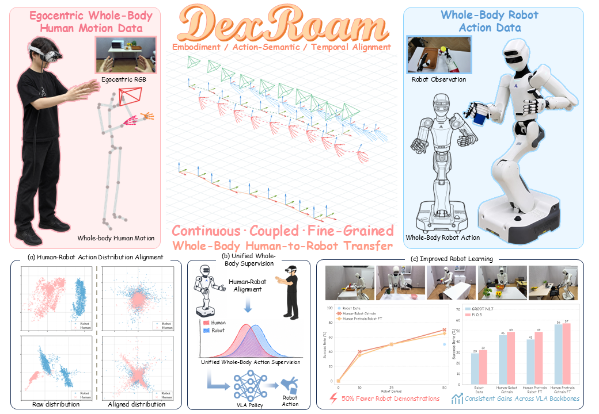

<div align="center">

# DexRoam: Learning Mobile Bimanual Dexterous Manipulation from Egocentric Whole-Body Human Demonstrations

[](https://dexroam.github.io/) [](https://arxiv.org/abs/2609.35761) [](https://github.com/zhourui9813/DexRoam-Policy-Training) [](https://docs.google.com/document/d/1fHvN4iPmd4ubBjKe_wXvZgA8-xidLD2B3mQOxtPLVF0/edit?tab=t.0) [](https://huggingface.co/datasets/zhourui9813/DexRoam_Realworld_Data)

[**Rui Zhou**](https://zhourui9813.github.io/)<sup>1,2,\*</sup>,
[**Yibo Yuan**](https://xiaoxiaoabo.github.io/)<sup>4,2,\*</sup>,
[**Junkai Zhao**](https://openreview.net/profile?id=~Junkai_Zhao1)<sup>2,\*,†</sup>,
[**Fangyuan Zhao**](https://scholar.google.com.hk/citations?hl=zh-CN&user=opKtK9oAAAAJ)<sup>3</sup>,
[**Xiaoguang Zhao**](https://openreview.net/profile?id=~Xiaoguang_Zhao1)<sup>5</sup>,
[**Shanghang Zhang**](https://scholar.google.com/citations?user=voqw10cAAAAJ)<sup>3,✉</sup>,
[**Sirui Han**](https://siruihan2024.github.io/)<sup>1,✉</sup>

<sup>1</sup>The Hong Kong University of Science and Technology &nbsp;
<sup>2</sup>Beijing Academy of Artificial Intelligence<br>
<sup>3</sup>State Key Laboratory of Multimedia Information Processing, School of Computer Science, Peking University<br>
<sup>4</sup>Beihang University &nbsp;
<sup>5</sup>Institute of Automation, Chinese Academy of Sciences

</div>

---

## 🔥 Highlights

**DexRoam** unlocks motion-level human data for mobile bimanual dexterous manipulation by transforming egocentric whole-body demonstrations into a continuous, coupled, robot-compatible action space. It provides a complete pipeline for tracker-free human motion capture, human-to-robot alignment, and VLA-based policy learning, enabling scalable learning from human demonstrations.

<p align="center"></p>

This repository provides the motion-capture and human-to-robot alignment stages of DexRoam, covering synchronized egocentric stereo recording, whole-body and hand-motion capture, HDF5 inspection, Astribot whole-body alignment, XHand retargeting, and temporal resampling.
<div align="center">
  
</div>


## 📋 Table of Contents

- [Repository Structure](#-repository-structure)
- [Human Motion Capture](#-human-motion-capture)
  - [Environment Setup](#1-environment-setup)
  - [Install ZED SDK and PyZED](#2-install-zed-sdk-and-pyzed)
  - [Install ADB](#3-install-adb)
  - [Hardware Setup](#4-hardware-setup)
  - [Quest 3 Prerequisites](#5-quest-3-prerequisites)
  - [Run the Capture System](#6-run-the-capture-system)
  - [Collect Demonstrations](#7-collect-demonstrations)
  - [Visualize Captured Trajectories](#8-visualize-captured-trajectories)
- [Human-Robot Alignment](#-human-robot-alignment)
- [Acknowledgments](#-acknowledgments)
- [Citation](#-citation)

## 📁 Repository Structure

```text
DexRoam/
├── assets/
│   ├── 3d_model/                             # Quest 3 and ZED Mini mounting model
│   └── media/                                # README images and setup videos
├── docs/
│   ├── Ego_Wholebody_Mocap_Reference.md      # Architecture, configuration, and troubleshooting
│   └── Human_Robot_Alignment_Reference.md    # Retargeting and resampling
├── ego_wholebody_mocap/                      # Real-time capture and HDF5 recording
├── human_robot_alignment/
│   ├── dexroam_alignment/                    # Alignment pipeline and CLI
│   ├── configs/                              # XHand retargeting configuration
│   ├── assets/xhand/                         # XHand URDF and meshes
│   ├── tests/                                # Alignment and resampling tests
│   └── third_party/                          # Pinned dex-retargeting source
├── scripts/
│   └── play_human_skeleton_trajectory.py     # Open3D playback for captured human motion
└── requirements.txt                          # Motion-capture environment
```

> 📚 **Detailed References**
>
> - **[Ego Whole-Body Mocap System Reference](./docs/Ego_Wholebody_Mocap_Reference.md)**: Code structure, Quest/ZED data flow, configuration parameters, runtime status, and troubleshooting.
> - **[Human-Robot Alignment Reference](./docs/Human_Robot_Alignment_Reference.md)**: Detailed usage of human robot alignment.

## 🥽 Human Motion Capture

The capture system uses a **Meta Quest 3** for head pose, 33 whole-body joint poses, and hand keypoints, together with a head-mounted **ZED Mini** for synchronized egocentric stereo RGB observations. It requires Ubuntu 20.04/22.04, Python 3.10, ZED SDK 4.x, PyZED, and ADB.

### 1. Environment Setup

Create and activate a Conda environment with Python 3.10, then install the project dependencies from the repository root:

```bash
conda create -n dexroam-egodata python=3.10
conda activate dexroam-egodata
pip install -r requirements.txt
```

### 2. Install ZED SDK and PyZED

#### 2.1 Install ZED SDK

Download a ZED SDK 4.x release that matches the Ubuntu and CUDA versions installed on the capture computer:

- [ZED SDK 4.2 releases](https://www.stereolabs.com/en-jp/developers/release/4.2)
- [ZED SDK installation guide for Linux](https://www.stereolabs.com/docs/development/zed-sdk/linux)

> [!IMPORTANT]
> ZED SDK 5.x and later versions are currently incompatible with this codebase.

For example:

```bash
sudo apt install zstd
chmod +x ZED_SDK_UbuntuXX_cudaYY.Y_vZ.Z.Z.zstd.run
./ZED_SDK_UbuntuXX_cudaYY.Y_vZ.Z.Z.zstd.run
```

Replace the placeholder version fields with the downloaded installer filename.

#### 2.2 Install PyZED

Follow the [PyZED Python API installation guide](https://www.stereolabs.com/docs/development/python/install). With the `dexroam-egodata` environment active, run the installer included with the ZED SDK:

```bash
conda activate dexroam-egodata
cd /usr/local/zed/
python3 get_python_api.py
```

After installation, verify that `pyzed` can be imported from the `dexroam-egodata` environment.

### 3. Install ADB

ADB provides communication and port forwarding between the Quest 3 and the Linux computer. Download [Android SDK Platform Tools](https://developer.android.com/tools/releases/platform-tools) and extract the archive, for example to:

```text
~/Android_SDK_Platform_Tools/
```

Add the `platform-tools` directory to `PATH` and reload the shell configuration:

```bash
echo 'export PATH=$PATH:$HOME/Android_SDK_Platform_Tools/platform-tools/' >> ~/.bashrc
source ~/.bashrc
```

If Platform Tools was extracted elsewhere, replace `$HOME/Android_SDK_Platform_Tools/` with the actual location.

Verify the ADB installation:

```bash
adb version
```

### 4. Hardware Setup

1. Assemble the Quest 3 and ZED Mini using the camera mount. See the [DexRoam Human Data Capture Hardware guide](https://docs.google.com/document/d/1fHvN4iPmd4ubBjKe_wXvZgA8-xidLD2B3mQOxtPLVF0/edit?tab=t.0#heading=h.qu6rzoh5te7b) for assembly details. The 3D-printable connector models are provided in [`assets/3d_model/`](./assets/3d_model/).
2. Connect the Quest Link cable between the Quest 3 and the computer.
3. Connect the ZED Mini USB cable between the camera and the computer.

> [!IMPORTANT]
> Connect both the Quest 3 and ZED Mini to USB 3.0 ports. Any USB hub or extension cable must support USB 3.0 data transfer and provide sufficient bandwidth.

### 5. Quest 3 Prerequisites

#### 5.1 Enable WebXR Experiments Settings

Open the Quest Browser, navigate to `chrome://flags`, search for `webxr`, enable the relevant **WebXR Experiments** flags, and restart the browser if prompted.

#### 5.2 Configure the Movement Boundary

Create a Quest movement boundary that covers the full data-collection area and is large enough to avoid safety warnings during demonstrations.

<div align="center">
  
</div>

#### 5.3 Allow USB Access

After putting on the Quest 3, open the system **Notifications** panel and select **USB connection detected**. The first connection may also require accepting the USB debugging prompt inside the headset.

### 6. Run the Capture System

#### 6.1 Verify the Quest 3 Connection

Run:

```bash
adb devices
```

A successful connection reports the headset with the `device` status:

```text
List of devices attached
1WMHH123456789    device
```

#### 6.2 Enable Port Forwarding

Forward port `8012` from the Quest 3 to the Linux host:

```bash
adb reverse tcp:8012 tcp:8012
```

The WebXR interface uses this port to communicate with the capture program.

#### 6.3 Configure the Output Directory

Set `OUTPUT_DIR` in `ego_wholebody_mocap/config.py`:

```python
# Base directory for capture output.
# Relative paths are resolved from project root.
OUTPUT_DIR = "data/test_data"
```

Each launch creates a timestamped run directory below the configured location, and saved demonstrations are written there as HDF5 files.

#### 6.4 Launch the Capture Program

From the repository root, activate the environment and launch the module:

```bash
conda activate dexroam-egodata
python -m ego_wholebody_mocap
```

The terminal prints the resolved output directory, gesture controls, ZED configuration, and WebXR server information.

> [!TIP]
> If the ZED camera reports an error during startup, unplug and reconnect its USB Type-C cable, then restart the capture program. This resolves most temporary connection failures.

#### 6.5 Open the Streaming Interface

Open the URL printed by the capture program in the Quest Browser. It is typically:

```text
https://vuer.ai?ws=ws://localhost:8012
```

The page displays the live ZED Mini stream. Use the button at the bottom of the page to enter either **Virtual Reality** or **Pass-through** mode. Initial stream latency usually stabilizes after a short period.

### 7. Collect Demonstrations

The capture system supports gesture-based recording control inside the Quest 3, so normal collection does not require interaction with the computer. Hold each pinch for approximately 0.2 s to activate it.

| Gesture | Function | Behavior |
| --- | --- | --- |
| Left index finger + thumb | **Start recording** | Starts recording after a 1 s delay |
| Left middle finger + thumb | **Stop recording** | Stops the active recording immediately |
| Right middle finger + thumb | **Discard demonstration** | Deletes the pending demonstration |
| Right ring finger + thumb | **Save demonstration** | Saves the pending demonstration to disk |

> [!TIP]
> To reduce accidental triggers, clearly pinch the designated finger and thumb while keeping the other fingers away from the thumb.

Use the following workflow for each demonstration:

1. Prepare the operator, task objects, and environment in their initial states.
2. Confirm that both hands are tracked and the ZED stream is stable.
3. Pinch the left index finger and thumb to arm recording; recording begins after approximately 1 s.
4. Perform the task.
5. Pinch the left middle finger and thumb to stop recording.
6. Inspect the demonstration quality. Pinch the right ring finger and thumb to save it, or the right middle finger and thumb to discard it.
7. Reset the scene and repeat for the next demonstration.

> [!NOTE]
> Discard demonstrations containing task failures, dropped objects, abnormal motion, tracking loss, or other invalid behavior.

<div align="center">
  
</div>

### 8. Visualize Captured Trajectories

Use `scripts/play_human_skeleton_trajectory.py` to inspect a saved human-motion episode in Open3D. The viewer replays the body, hands, and head pose, and can also display the chest or head trajectory, ground grid, camera frustum, and recorded ZED image.

```bash
python scripts/play_human_skeleton_trajectory.py path/to/episode0001.h5 --loop
```

| Key | Action |
| --- | --- |
| `Space` | Play or pause |
| `N` / `Right` | Advance one frame |
| `P` / `Left` | Go back one frame |
| `R` | Restart from the selected first frame |
| `T` | Show or hide the trajectory |
| `Y` | Switch between chest and head trajectory |
| `F` | Cycle through frustum display modes |
| `G` | Show or hide the ground grid |
| `L` | Enable or disable looping |
| `Q` / `Esc` | Quit |

## 🤖 Human-Robot Alignment

The alignment module maps the captured human base, torso, arm, head, and hand motion into the Astribot–XHand representation. It can resample episodes to a fixed length, to the average length of a robot demonstration set, or by a playback-speed factor calculated independently for each episode.

Create a separate environment and enter the module directory:

```bash
conda create -n dexroam-alignment python=3.10
conda activate dexroam-alignment
pip install -r human_robot_alignment/requirements_alignment.txt
cd human_robot_alignment
```

Align a directory and resample each human episode to the average length of the robot demonstrations:

```bash
python -m dexroam_alignment path/to/human_dir \
  -o path/to/output_dir \
  --recursive \
  --robot-dir path/to/robot_dir
```

The files passed through `--robot-dir` are used only to determine the target sequence length; their poses are not used for retargeting. For input/output schemas and retargeting details, see the **[Human-Robot Alignment Reference](./docs/Human_Robot_Alignment_Reference.md)**.

## 🙏 Acknowledgments

We thank the authors of [dex-retargeting](https://github.com/dexsuite/dex-retargeting) and [Vuer](https://github.com/vuer-ai/vuer) for their open-source contributions.

## 📄 Citation

If you find DexRoam helpful, please consider giving this repository a ⭐

```bibtex
@article{zhou2026dexroam,
  title={DexRoam: Learning Mobile Bimanual Dexterous Manipulation from Egocentric Whole-Body Human Demonstrations},
  author={Zhou, Rui and Yuan, Yibo and Zhao, Junkai and Zhao, Fangyuan and Zhao, Xiaoguang and Zhang, Shanghang and Han, Sirui},
  journal={arXiv preprint arXiv:2609.35761},
  year={2026}
}
```
